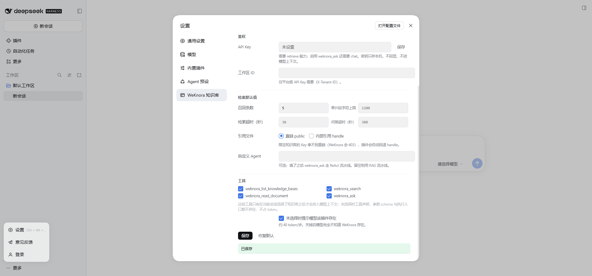
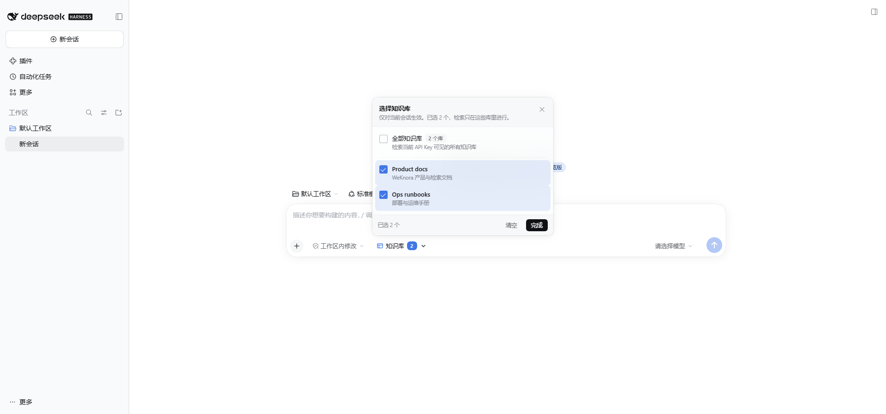
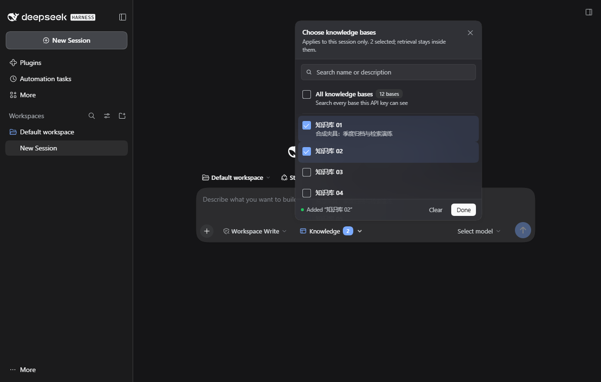

# dsh-weknora

**把 WeKnora 的知识库接成 DeepSeek Harness 的四个工具，并配一个可视化配置页和一个会话级知识库选择器。**

装上它之后，你可以让 Agent 直接检索自己的内部文档；不选知识库时，它**一个工具都不会出现在上下文里**——不占 token，也不给模型调错的机会。

**English** | [简体中文](./README_CN.md)



<p align="center"><sub>设置 → WeKnora 知识库：地址、密钥、检索默认值与工具开关都在这一页</sub></p>

---

## 目录

- [它解决什么问题](#它解决什么问题)
- [安装](#安装)
- [快速开始](#快速开始)
- [截图](#截图)
- [四个工具](#四个工具)
- [工具可见性：未选择 = 零工具](#工具可见性未选择--零工具)
- [权限与数据流](#权限与数据流)
- [配置项](#配置项)
- [开发](#开发)
- [兼容性](#兼容性)
- [与上游的关系](#与上游的关系)
- [许可](#许可)

## 它解决什么问题

工具型插件最常见的两个失败模式，这个插件专门绕开了：

1. **工具常驻上下文，白烧 token。** 四个工具的 JSON Schema 每轮都在提示词里，哪怕这次对话跟知识库毫无关系。
   这里的做法是**按步求值**：只有当某个会话选了知识库，工具才注册进那一步；没选就是零 schema、零 token。
2. **检索范围靠模型自己说。** 让模型选知识库，它要么选错、要么把整个租户都搜了。
   这里的范围**由用户在选择器里定**，模型的入参只能收窄、不能扩大；越界会被明确拒绝而不是"顺手"放宽。

另外两件事也是设计目标：

- **密钥不该出现在配置行里。** 配置行会被每个设置查询读取、被诊断导出、被备份。API Key 只存在本机凭据文件里，只写不回显。
- **改配置不需要重启。** 设置页保存后，下一步模型调用就生效。

## 安装

> **版本说明**：npm 上目前是 `0.1.0`，**没有**配置页与会话选择器。本仓库是 `0.2.x`（新增了可视配置、会话级选择器、隐藏未选时的工具）。想用 0.2.x，请按下面从仓库安装。

### 从本仓库安装（推荐）

```sh
git clone https://github.com/1321928757/dsh-weknora.git
cd dsh-weknora
npm install          # 会装上 esbuild：客户端半身是打包产物
npm run build
npm pack             # 产出 wxg-prc-cpg-dsh-weknora-0.2.2.tgz
dsh plugin add --profile <你的profile> file:./wxg-prc-cpg-dsh-weknora-0.2.2.tgz
```

用 tarball 而不是直接 `dsh plugin add <目录>`，是因为后者会触发 `prepare` 构建，需要 pnpm 10 放行该包的构建脚本；tarball 里已经带了 `dist/`，装上就能用。

### 从 npm 安装（0.1.0，无配置界面）

```sh
dsh plugin add --profile <你的profile> @wxg-prc-cpg/dsh-weknora
```

装上后插件默认指向 `http://localhost:8080/api/v1` 且没有密钥，所以第一次打开选择器会显示**「还没有配置 WeKnora」**——去设置页填地址和 Key 即可。

## 快速开始

**① 配置**：设置 → **WeKnora 知识库**，填服务地址与 API Key，点「测试连接」。成功会显示往返延迟与该凭据可见的知识库数量。

**② 选库**：输入栏左侧的**知识库**按钮 → 勾选一个或多个库（也可以选「全部知识库」）。

**③ 提问**：从**下一步**开始，四个 `weknora_*` 工具就出现在这个会话里了。清空选择则下一步回到零工具。

```
设置 → WeKnora 知识库 → [地址] [API Key] → 测试连接 → 保存
输入栏「知识库」→ 勾选「产品文档」→ 完成
"帮我查一下灰度发布要检查哪些项"   ← 模型这次能看到 weknora_search 了
```

## 截图

| 会话级选择器（明色） | 选择器（暗色） |
|---|---|
|  |  |

选择器的最小可用形态只有三件事：搜索、多选、清空。页脚常驻一行状态，说清"当前未选择、工具不可用"或"已选 N 个"——用户不需要猜自己现在能不能检索。

## 四个工具

| 工具 | 调用的 WeKnora 接口 | 模型拿到什么 |
|---|---|---|
| `weknora_list_knowledge_bases` | `GET /knowledge-bases` | 知识库名称与 id，用于说明有哪些库，或为后续检索缩小范围 |
| `weknora_search` | `POST /knowledge-search` + `GET /knowledge/search` | 原文片段与排序，每条带 `knowledge_id`、得分、分块序号，外加查询点名的文档 |
| `weknora_read_document` | `GET /chunks/:knowledge_id` + `GET /knowledge/:id` | 单个文档按序拼回的正文，开头给出标题与摘要，支持翻页 |
| `weknora_ask` | `POST /sessions` + `POST /knowledge-chat/:id` 或 `POST /agent-chat/:id` | WeKnora 自己的答案、引用、服务端用过的工具，以及可续聊的 `session_id` |

`weknora_search` 是主力：它把原文交给 Agent 自己推理，结论因此可审计。它在同一次调用里同时匹配片段内容和文档名——"那个叫 X 的文档"不需要模型先猜 id。

`weknora_ask` 把整个问题委派给 WeKnora，适合跨多篇文档、需要综合的问题（自己检索要来回好几轮）。填了自定义 Agent 时走 ReAct 流水线，范围由该 Agent 自己的选择模式在服务端解析。

`weknora_read_document` 的存在是因为检索返回的是碎片：一旦某个片段看起来对，通常还需要它的上下文。

在 [Code Mode](https://github.com/deepseek-ai/deepseek-harness/blob/master/packages/core/tools/README.md) 下同样可用：`await tools.weknora_search({ query })`，一段程序里扇出十个子问题，而不是十次模型往返。

## 工具可见性：未选择 = 零工具

工具带一个**逐步求值**的启用条件："本会话至少选了一个知识库"。

| 会话状态 | 模型看到什么 |
|---|---|
| 未选择 | **零个 `weknora_*` 工具**：没有 schema、不占提示词，即使系统提示提到名字也调不到 |
| 选了库 | 下一步立刻出现全部四个工具 |
| 又清空 | 下一步回到零个 |

可见性**校两次**：注册期决定工具是否出现，执行期再校验一次。仍然进来的调用会被**拒绝**，不会放宽范围：

- 会话没选任何知识库 → 拒绝，并提示模型让用户先去选；
- 模型点名了会话没选的知识库 → 拒绝并回显该 id，不会"顺手"搜该凭据可见的全部库；
- 目录尚未就绪（冷启动、后端不可达）→ 拒绝，提示稍后重试。

未选择期间插件会往对话里加**一行**提示，让模型知道"有检索但没启用"，避免它把自己的无工具回答当成"这个产品没有检索功能"。不想要这行可以关（设置页 → 工具 → 未选择时提示），关掉后模型完全不知道 WeKnora 存在。

## 权限与数据流

插件**只读**：不入库、不改分块、不删除。四个工具里三个只需要 `retrieve` 能力的 API Key；`weknora_ask` 还需要 `chat`（它要建会话并流式回答）。

密钥经 `X-API-Key` 发送；平台级 Key 另外需要 `tenantId`（`X-Tenant-ID`）。错误只带 HTTP 状态与 WeKnora 自己的原因，**从不带密钥**。

片段内容在进入模型前按 `maxChunkChars` 裁剪，并明确标记 `truncated: true`，不会静默吞掉正文。

默认 `resourceUrls: public`：WeKnora 会把引用的 `resource://` 图改写为可直接加载的 `http(s)` 地址，Markdown 图片粘进回复就能显示。限定知识库的 Key 拿不到直链（WeKnora 返回 403），插件会自动回退到 handle 模式并保持。

随包提供的 `cordis.patch.yml` 只读两个环境变量：`WEKNORA_BASE_URL` 与 `WEKNORA_TOOL_PREFIX`。其余字段——包括密钥——都是设置项。

### 密钥怎么存

API Key 写在 `$DSH_HOME/storages/dsh-weknora/credentials.json`（尽力 0600），**不进配置行**：配置行会被设置查询读取、被诊断导出、被备份带上。设置页只报告"已设置/未设置"，不回显明文，并提供替换与清除。

### RPC 面是什么，不是什么

设置页与选择器通过插件自己的 RPC 命名空间访问宿主。这个面**只面向本地 shell，不是会话之间的授权边界**：宿主看不到是哪个窗口发起的调用，因此信任传入的 `sessionId`。单用户桌面上两个调用方本来就是同一个人，所以这个取舍可以接受；但不要把它暴露给不受信任的客户端并期待会话隔离。

即便如此，两件事仍然守住了（写错就是丢凭据）：

- **已保存的 API Key 只会发往当前配置的源。** 测另一个地址时不带密钥，除非在同一次调用里显式提供；
- **`setApiKey` 缺参数会被拒绝，而不是当成"清除"。**

## 配置项

| 字段 | 默认值 | 说明 |
|---|---|---|
| `baseUrl` | `http://localhost:8080/api/v1` | 缺少 `/api/v1` 时自动补全 |
| `apiKey` | 未设置 | **不在配置行里**，见上文"密钥怎么存" |
| `tenantId` | 未设置 | 平台级 Key 需要 |
| `knowledgeBaseIds` | `[]` | 模型未指定范围时的默认范围；为空表示用会话选择 |
| `agentId` | 未设置 | 让 `weknora_ask` 走 ReAct 流水线 |
| `maxResults` | `8` | 同时是 `max_results` 与引用条数的上限 |
| `maxChunkChars` | `1200` | 单片段字符预算 |
| `requestTimeoutMs` | `30000` | 检索与文档读取 |
| `chatTimeoutMs` | `300000` | `weknora_ask`，要等 WeKnora 自己的模型调用 |
| `resourceUrls` | `public` | `public` 返回可直链；`handle` 保留内部 `resource://` 引用 |
| `toolPrefix` | `weknora` | 工具名前缀，需匹配 `^[a-z][a-z0-9_]*$`（改后需重载插件） |
| `tools.*` | 全为 `true` | 少注册几个工具就少占几分提示词；设置页不允许全部关掉 |
| `hintWhenUnselected` | `true` | 未选择时是否加一行提示 |

## 开发

```sh
npm install        # 会装上 esbuild：客户端半身是打包产物，不经过 tsc
npm test           # 先构建，再跑单测与契约测试
npm run typecheck
```

这个包有**两个半身**。`tsc` 只产出宿主半身（`dist/*.js`）；客户端半身由 **esbuild** 打成单个 `dist/client/client.js`，自行注册到 web shell 的模块加载器（`scripts/build-client.mjs`）。esbuild 只是 `devDependency`：从 npm 装到的包带的是构建产物，安装时不会跑构建。

端到端检查会把包装进一个一次性 profile，对着 mock 的 WeKnora 后端和确定性假模型启动，断言 harness 真的调了工具、并且答案来自工具返回：

```sh
npm run build
node test/e2e/run-in-dsh.mjs                        # 首次会从 npm 装 dsh
DSH_BIN=/path/to/dsh node test/e2e/run-in-dsh.mjs   # 或复用已有安装
```

dsh 需要支持 zstd 的 Node（≥ 22.15 或 ≥ 24）做会话持久化，并且 `PATH` 上要有 pnpm ≥ 10——`dsh plugin add` 是通过 pnpm 装进 profile 的。插件自身只要求 Node ≥ 20.11。

`test/fixtures/api-contract.json` 记录了这个插件发出的**每一次** WeKnora 调用。`test/contract.test.mjs` 断言插件仍然只发这些调用，`contract/contract_test.go` 断言 WeKnora 真实的 Go 请求/响应类型仍然接受并返回它们——任一侧改名都会让 CI 失败，而不是让用户的 Agent 失败。

## 兼容性

已针对 dsh `0.2.2-rc.3` 与 WeKnora `0.8.0` 验证，`engines.dsh` 为 `>=0.2.2-rc.1 <0.3.0-0`。dsh 处于 developer preview 并明确会有破坏性变更；本包只依赖 `@deepseek-ai/schemastery` 与 `zod`（**不依赖任何 dsh 包**），因此不锁任何 harness 版本。若某个 dsh 版本改了工具定义契约，请开 issue。

## 与上游的关系

这个仓库是 **WeKnora 官方 dsh 插件的二次开发**：在原有的四个检索工具之上，新增了

- 设置页里的「WeKnora 知识库」配置分区（地址、密钥、默认值、逐工具开关、连通性自检）；
- 会话输入栏的知识库选择器（多选、全选、清空、搜索），以及"未选择即零工具"的可见性模型；
- 密钥与配置分离（凭据文件而非配置行）、错误信息本地化、明暗双主题的表面材质对齐。

工具层与 WeKnora API 的调用形状沿用上游，未做破坏性改动。

## 许可

MIT，与 WeKnora 和 dsh 一致。见 [LICENSE](./LICENSE)。
